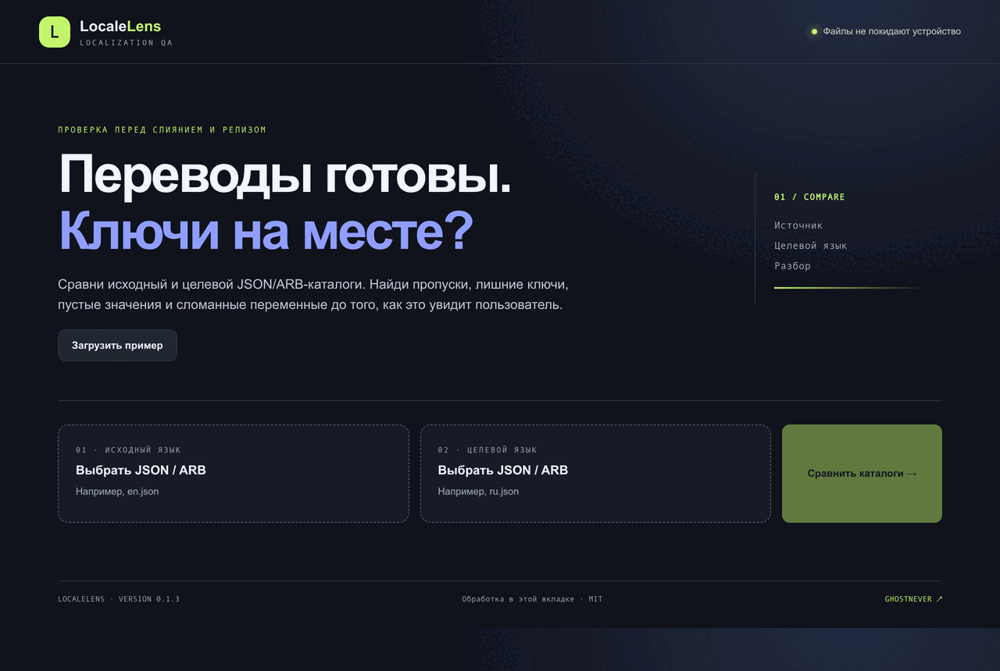

# LocaleLens

LocaleLens is a local-first checker for JSON and ARB localization catalogs. Compare a source catalog with a translated one and inspect missing keys, target-only keys, empty values, type mismatches, and interpolation placeholder differences.



## Run locally

Requires Node.js 20 or newer. No package installation is needed.

```sh
npm start
```

Open <http://127.0.0.1:4183>. Load two `.json` or `.arb` files or use the built-in example. Files are read in the browser and are not uploaded.

## Download

Download the **Source code (zip)** archive from the [latest release](https://github.com/GhosTnever-lkm/localelens/releases/latest), then open `index.html` in a modern browser.

## Checks

```sh
npm test
npm run check
```

## Scope

Nested objects become dotted keys. If a dotted literal key collides with a flattened nested path, the catalog is rejected rather than silently losing a value. The checker compares key presence, value types, empty target strings, and common `{name}`, printf `%s`, positional `%1$s`, and named `%(count)d` placeholders. It does not judge translation quality, parse comments, or fully validate ICU plural/select branches. Each file is limited to 10 MiB.

## License

MIT.
